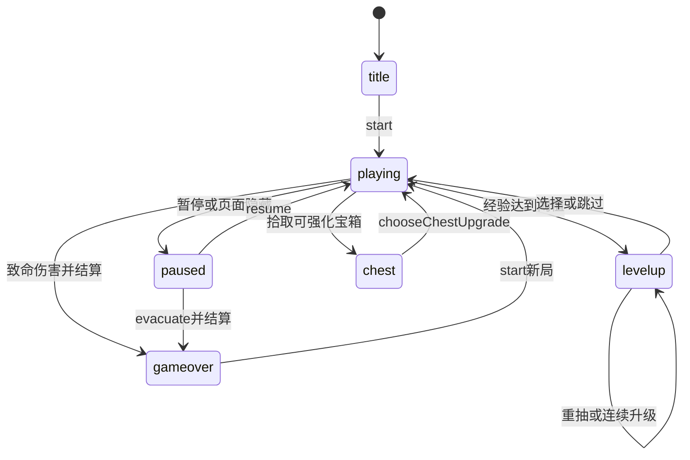

# 架构文档（历史基线与当前扩展）

> 第 1～10 节保留基线提交 `9dbeb1b` 的旧架构补记，其中的功能缺口描述只适用于扩展前。
> 第 11 节按 2026-11-12 本地工作区源码补记当前策略构筑扩展；玩法契约见 [`gameplay-design.md`](gameplay-design.md)。浏览器、性能与打包证据见 [`acceptance.md`](acceptance.md)。
> 仓库原先只有教学材料 `tutorial.md` 与 REA 分析快照，没有运行时架构文档，这里补全。

## 1. 目标与边界

- 纯静态前端：ES Module + Canvas 2D + Web Audio，无运行时依赖、无外部图片/字体/CDN。
- 单页：`index.html` 内含 HUD 与覆盖层 DOM，`src/main.js` 为唯一入口。
- 无账号、无服务器；手机（虚拟摇杆 + 闪避键）与桌面（WASD/方向键）双端支持。
- 手机默认较低渲染精度，持续掉帧时自适应降级，恢复较慢以避免抖动。
- 参考样本仅借鉴自包含 HTML、Canvas、输入、HUD 与帧循环等高层结构，不复制内容。

## 2. 目录与模块职责

| 路径 | 职责 |
| --- | --- |
| `index.html` | 画布、HUD、标题/升级/暂停/结算覆盖层、手机控件 DOM |
| `src/main.js` | 创建模块、rAF 帧循环、`pagehide/pageshow`；暴露 `window.__MOON_SURVIVOR__` 供验收 |
| `src/core/math.js` | `mulberry32` 确定性随机数、`clamp/distance/normalize` |
| `src/core/input.js` | 键盘/触屏采样，输出 `{moveX,moveY,dash,isTouch}` |
| `src/game/game.js` | `SurvivorGame`：全部规则与状态 |
| `src/game/world.js` | 固定世界 3200×2200（中心原点）、边界与镜头夹取 |
| `src/game/spatial-grid.js` | 弹体—敌人碰撞粗筛（64px 格，对象池复用） |
| `src/render/canvas.js` | 镜头、地形、星点、宝石、弹体、敌人、粒子、玩家、边界、威胁箭头、脚印 |
| `src/render/terrain.js` | 固定荒野遗迹地景，按视口裁剪 |
| `src/render/sprites.js` | 敌人/宝石/弹体精灵缓存（上限 96） |
| `src/render/quality.js` | 三档画质，持续掉帧降级、缓慢恢复 |
| `src/audio/game-audio.js` | Web Audio 解锁/恢复/静音/复音上限，可注入依赖以便测试 |
| `src/ui/ui.js` | HUD、覆盖层、升级选择、结算、音效反馈、可见性暂停 |
| `src/ui/style.css` | 全部样式与窄屏适配 |
| `scripts/` | 静态服务、浏览器验收、打包、REA 提取 |
| `tests/` | 单元、回归、性能等价、静态服务测试 |

## 3. 帧循环与数据流

```text
rAF(timestamp)
  seconds = (timestamp - lastTime) / 1000
  renderer.recordFrame(ms, playing)      // 画质采样，可能 resize
  game.particleLimit = quality.particleLimit
  controls = input.sample()
  game.update(seconds, controls, viewport)
  renderer.draw(game, timestamp / 1000)
  ui.render(game)                        // HUD / 覆盖层 / 音效
```

- 逻辑与渲染同帧、变步长；`update` 将 `delta` 夹至 `[0, 0.05]`。
- 渲染只读游戏状态；UI 通过上一帧快照触发音效和 Toast。
- `pagehide` 停止循环，`pageshow` 重置时间后恢复。

## 4. 状态机

```text
title ──start──▶ playing ◀──resume── paused
                   │  ▲                ▲
         升级经验满 │  │ chooseUpgrade  │ pause / 页面隐藏
                   ▼  │                │
                 levelup ──────────────┘
playing ──血量归零──▶ gameover ──start──▶ playing
```

- 仅 `playing` 推进模拟。
- `chooseUpgrade` 回到 `playing` 后再次检查，允许连升。
- 死亡优先于同帧经验拾取（由回归测试固定）。

## 5. 游戏核心

### 5.1 实体

- `player`：位置、半径、生命、速度、伤害、攻击间隔、弹体参数、吸取范围、经验/等级、无敌、闪避、朝向。
- `enemy`：`id/type/x/y/hp/maxHp/speed/radius/damage/color/xp/hitFlash/contactClock`。
- `projectile`：位置、速度、半径、伤害、寿命、穿透、`hitIds`、拖尾。
- `gem`：位置、半径、经验值、相位、颜色。`particle`：位置、速度、寿命、半径、颜色。

### 5.2 `update` 顺序

1. 夹取 `dt`，推进计时，衰减震屏、无敌和闪避冷却。
2. 移动与闪避；位置夹入世界。
3. 刷怪：间隔从 1.25s 随 `elapsed` 降至 0.25s；4 种敌人按权重抽取；视口外圆环生成，最多重试 12 次。
4. 自动攻击：找最近敌人；单射线/散射生成弹体。
5. 弹体移动与碰撞；敌人追踪与接触伤害；经验吸取；粒子。
6. 血量归零切 `gameover`。

### 5.3 基线内容

- 4 种敌人：`shade/runner/brute/wraith`，仅直线追踪 + 接触伤害。
- 8 类纯数值升级：伤害、攻速、生命、移速、吸取、弹数、穿透、弹体范围/速度。
- 每 60 秒音效提示“暗潮”，但无实际玩法变化。
- 闪避：0.19s、3.1 倍速、2.1s 冷却、0.24s 无敌。

## 6. 渲染与性能不变量

- 世界固定大小，镜头只在边界处夹取；地形按世界坐标绘制，不随玩家漂移。
- 屏幕外敌人不绘制，但保留“各方向最近威胁”箭头（12 扇形）。
- 粒子有渲染预算，移动端默认更低；生成 RNG 消耗与预算无关，避免改变后续刷怪/经验序列。
- 弹体碰撞使用 `SpatialGrid`：每帧 rebuild，查询候选按敌人原始顺序排序，保证命中和掉落顺序确定。
- 敌人与弹体在数组内 splice；网格通过 `removed` 集合忽略本帧已死敌人。

## 7. 输入与 UI

- 输入是采样式：每帧读取当前按键/摇杆状态；键盘防止空格滚动。
- 桌面：WASD/方向键移动，空格/Shift 闪避。
- 手机：识别 `pointer: coarse` 或 `maxTouchPoints` 后显示虚拟摇杆与闪避键；使用 Pointer Events 和 pointer capture。
- 升级时暂停模拟，展示 3 个候选；UI 直接创建按钮并绑定点击。
- 页面隐藏时暂停并 park 音频；返回时按条件恢复，显式静音保留。

## 8. 音频

- `GameAudio` 自管 `AudioContext`、主增益、环境音与短音效。
- 解锁必须在用户手势路径内；状态分 `idle/pending/ready/blocked/muted` 类反馈（由 UI 呈现）。
- 有复音上限、事件间隔节流、结束节点断开与页面隐藏释放，避免节点无限增长。

## 9. 测试与验收

- `npm test`：游戏规则、确定性、随机消费、空间网格等价、粒子预算、音频状态机、画质、服务。
- `npm run test:browser`：桌面 Chrome/Edge 自动验收，覆盖启动音频信号、声音暂停/恢复、静音重开、绘制缓存、屏幕外裁剪。
- `npm run package`：复制静态文件到 `output/release`。
- 浏览器测试需要 Node 22.12+ 与 Chrome/Chromium；`CHROME_PATH` 可指定路径。
- 音频信号检查不能代替扬声器；手机真机首次发声、后台恢复、听感与帧率需实测。

## 10. 已知缺口与风险

- 玩法单薄：单一武器、纯数值升级、无局外成长；怪物只有直线追踪。
- 无存档；无角色选择；移动端只有窄屏 CSS，没有横屏/安全区专门适配。
- 模拟与表现耦合在 `game.js`，实体种类增加后文件会过大，需要拆分数据/系统。
- 只有桌面自动化验收；手机模拟视口存在，但真机未验证。
- `fireVolley`、`updateProjectiles` 的射击/碰撞逻辑仍是以旧字段为中心的窄实现，扩展武器时必须保持空间网格与 RNG 确定性。

## 11. 当前策略构筑扩展（工作区源码补记）

本节描述当前实现的数据归属与调用关系，不代表功能、浏览器、性能或真机验收已经通过。第 1～10 节继续作为历史对照；当前实现以本节和玩法文档第 9 节为准。

### 11.1 模块与装配

| 路径 | 当前职责 |
| --- | --- |
| `src/game/content.js` | 冻结的内容表：`WEAPONS`、`PASSIVES`、`CHARACTERS`、`ENEMIES`、`BOSSES`、`META_UPGRADES`、`ACHIEVEMENTS`、`ALTARS`、`PICKUP_TYPES`；不存运行计时器 |
| `src/game/game.js` | `SurvivorGame` 仍为规则所有者：角色开局、构筑/属性、候选/进化、武器、敌人行为、导演、掉落/祭坛、成就与结算摘要；导出 `ENTITY_LIMITS` |
| `src/game/progression.js` | 存档默认值/规范化、`SaveStore`、回响计算、购买刻印和角色解锁；纯函数不依赖 DOM |
| `src/main.js` | 装配存档、游戏、渲染、输入和两层 UI；直接复用 `SaveStore` 读写局外档案；局外修改在下一次开局交给游戏 |
| `src/ui/ui.js` | `GameUI`：HUD、角色入口、升级/宝箱/暂停/结算、输入隔离、音频反馈、结算入账与页面内幂等检查 |
| `src/ui/meta-ui.js` | `MetaUI`：潮回声廊的刻印、角色、成就页；通过 `setRunProgress()` 接收本局成就进度快照，购买/选择交由装配层处理 |
| `src/render/canvas.js` | 绘制刀刃、持续区域、弹幕、祭坛、拾取物、预警与首领，靠近祭坛时提示风险/收益，保留世界镜头、地形、缓存、裁剪和画质系统 |
| `src/render/sprites.js` | 继续缓存程序化精灵，并为 4 种新增普通怪和 2 种首领绘制可区分的符号 |
| `index.html`、`src/ui/style.css` | 静态覆盖层与手机横竖屏布局；宝箱覆盖层由 `GameUI.showChest()` 首次打开时创建 |
| `tests/strategy.test.mjs`、`tests/combat.test.mjs`、`tests/progression.test.mjs` | 构筑、六进化实际伤害、八敌人、两首领、成就/死亡顺序、实体预算、存档/购买回归 |
| `scripts/browser-launch.mjs` | 独立测试配置目录、浏览器启动交接恢复与关闭回收 |
| `scripts/strategy-browser-check.mjs`、`scripts/release-check.mjs` | 双端完整流程、旋转与双指验证；部署包文件一致性与流程验证 |
| `scripts/performance-check.mjs`、`scripts/frame-performance-check.mjs` | 逻辑/耐久/保留内存和浏览器更新+绘制的基线对比 |

`content.js` 没有 `WAVES` 导出。基础填充、每分钟合围、精英和首领调度目前都在 `SurvivorGame.updateDirector()` 中，由 `nextWave/nextElite/nextBoss/prewarnings` 驱动。

### 11.2 当前状态机与界面层



- 规则状态只有 `title/playing/paused/levelup/chest/gameover`，仅 `playing` 推进模拟。重抽不恢复模拟；跳过后立即重新检查升级。
- 潮回声廊和指南由 `metaOpen/tutorialOpen` 管理，是覆盖层标记，不是新增的 `game.state`。从游戏中打开时先暂停；输入通过 `isInputBlocked()` 和 UI 操作守卫隔离，关闭后按原入口恢复。
- `startRun()` 在标题/结算入口执行 `setProfile → setCharacter → start/reset`；角色、永久强化与剩余次数在此重新建立。`evacuate()` 只允许从暂停状态执行。
- 核心入口为 `start(characterId = null, seed = this.seed)`，可显式传入第二参数种子，省略时沿用 `this.seed`，便于固定条件复现。正常 UI 每次开局生成新种子并调用 `game.start(null, seed)`：优先使用 `crypto.getRandomValues()`，不可用时回退时间与局序号；若与上一局种子相同则调整，避免连续重开初始内容相同。种子和局内状态均不存档。
- 致命伤害先生成结算摘要并进入 `gameover`，本帧后续敌人、区域、经验和拾取流程遇到非 `playing` 状态立即停止，保留死亡优先规则。

### 11.3 构筑、派生属性与运行状态

| 数据 | 所有者与用途 |
| --- | --- |
| `game.build` | `{ weapons: [{ id, level, evolved }], passives: { [id]: level } }`，最多 4 武器 + 4 被动；没有 `player.build` |
| `game.player` | 位置/生命/经验，以及派生的 `damageMultiplier/cooldownMultiplier/areaMultiplier/xpMultiplier/pickupChance`、移速、磁吸、闪避冷却和月痕箭兼容字段 |
| `game.runMeta` | `reset()` 时复制 `profile.meta` 的本局快照；`recalculateStats()` 从它读取永久强化 |
| `game.weaponClocks` | 按武器 ID 保存周期武器冷却；月痕箭仍使用 `fireClock`，环葬刃另有 `orbitHits/orbitTrailClock/orbitBlades` |
| `game.upgradeChoices/chestChoices` | 当前可选候选；由 `rollUpgradeChoices(chest)` 生成并通过相应选择方法应用 |
| `game.enemyProjectiles/projectiles/zones/effects` | 敌方弹体、玩家弹体、持续区域及表现/延迟效果；均不属于内容配置或敌人自身数组 |

`applyChoice()` 统一检查槽位、满级和进化条件，再调用 `recalculateStats()`。UI 用 `game.describeChoice(choice)` 获得数值变化与进化说明，避免在界面重写伤害公式；没有独立的 `stats` 对象、`weaponStates` 或 `getUpgradeChoices()` 契约。

`rollUpgradeChoices()` 先放入满足条件的进化项，再从其余合法候选中按权重无放回抽取：新项权重 1、已有强化权重 2，与已有武器匹配的被动再乘 1.4。最多提供 3 项；不足 3 项时展示全部合法项，无可用构筑项时回血兜底，不虚构新项或重复候选。宝箱仍只强化已有构筑，因此开局只有 1 件武器时可以只显示该武器的 1 项合法升级。

局外购买、偏好修改和角色选择只更新装配层/UI 的档案；本局期间不调用 `game.setProfile()`。下一次 `startRun()` 才重新注入档案并建立 `runMeta`，避免祭坛或升级重算属性时把新购买的刻印应用到进行中的战斗，也避免局内成就账本被重置。

### 11.4 当前帧流程、导演与伤害归属

1. 仅在 `playing` 下将有效 `dt` 夹至 `[0, 0.05]`，推进时间及冷却、移动和闪避，夹取世界边界。
2. 更新刷怪导演与祭坛；重建敌人空间网格；执行月痕箭及其他武器。
3. 更新玩家弹体、敌方弹体、敌人行为；每阶段检查是否已经死亡/离开 `playing`。
4. 敌人移动后，若本帧有区域伤害或延迟效果到期，则重建网格；处理区域、效果、经验、拾取物、粒子与成就。
5. rAF 保持 `game.update → renderer.draw → ui.render`；画质系统只向逻辑提供粒子预算，不改怪物、伤害或经验规则。

导演在波次、精英和首领事件前 3 秒写入 `toastEvent`，由 UI 显示并触发音效。首波合围在 60 秒，首波精英在 120 秒、每波随机 2～4 只，首领调度从 180 秒起每 180 秒一次；已有首领存活时不叠加生成新首领。精英后续间隔为 `max(60, 110 - floor(elapsed / 180) × 15)` 秒。10 分钟后的普通怪 HP 和速度都有额外的无上限时间增长项，不会在前期封顶值停住。

普通怪占满 800 个敌人名额时，定时精英会替换普通怪腾位；首领生成同样腾位，避免事件因普通怪占满预算而静默错过。腾位同步调用网格 `remove()`，不作为击杀结算或产生掉落。

敌方弹体只检测玩家，不伤害敌人；此规则包括远程普通怪与两种首领弹幕。`bomber` 爆炸生成 `hostile` 危险区，区域既可伤玩家，也通过 `damageCircle()` 伤敌人。两类伤害归属需要分开验收。

### 11.5 结算幂等与成就局内账本

- `reset()` 创建 `runId`；当前格式是种子加当前游戏实例递增的 `runSequence`。`finishRun()` 缓存 `summary`，重复调用返回同一份摘要。
- 成就达成时写入 `earnedAchievements/achievementRewards`，并结合开局档案的已解锁记录去重；不会直接把奖励写入局外余额。`finishRun()` 将基础回响和成就回响分别放入摘要，死亡折扣与祭坛加成仅作用于基础回响。
- `GameUI.applyRunResult()` 用摘要对象的 `settledSummaries`（`WeakSet`）和 `runId` 的 `settledRuns`（`Set`）拦截重复展示/重复入账，再一次性更新回响、统计和成就。
- 结算幂等账本只保存在当前 UI 实例内存，不写入存档；局外购买、偏好变化和打开覆盖层都不会重建这两个集合，也不会重置游戏的局内成就账本。
- 当前 ID 只在游戏实例内递增，刷新后相同种子的序号会重新开始；刷新也会清空页面结算账本，并按“不续存单局”的规则回到标题。已移除跨刷新持久化的 `settledRunIds`，避免新局因相同种子/序号被误判为已入账。这里承诺的是页面生命周期内幂等，不是跨会话重放结算。

### 11.6 存储健壮性及实际边界

- 基础 `SaveStore` 使用 `moonlit-survivor-save-v1`、版本号 1；构造时捕获 `localStorage` 访问异常，读写/清除异常不阻塞游戏。
- `normalizeSave()` 只读白名单自有字段，过滤未知成就/角色，限制刻印等级；负数、非有限数、缺失字段和非法版本按规则规范化或回退默认值。命运刻印上限为 2，其余刻印为 5。
- `SaveStore.memory/pendingWrite` 保留写入/清除失败后的内存新值，避免同实例再次 `load()` 时恢复旧磁盘档；输入和返回值均经过规范化，避免引用污染。
- 实际入口直接使用 `new SaveStore()`，没有绕开基础类内存缓存和失败写入标记的存储子类。`normalizeSave()` 保留回响、刻印、角色、成就、统计和偏好；页面内幂等集合不属于存档 schema。
- 不在每帧写盘，不保存种子或进行中的单局；结算、购买、角色/声音/引导偏好变化才触发保存。存储不可用时可以继续玩，但刷新后的持久保留需要成功写入存储。

### 11.7 空间网格与实体预算

敌人网格仍为 64px 格，保存中心点并用最大敌人半径扩展查询，复用行、桶和候选数组。候选按原始敌人顺序排序，死亡通过 `remove()` 标记；玩家弹体、圆形范围伤害、刀刃和连锁跳跃使用网格粗筛。大范围或稀疏查询会遍历已占用桶以避免空格扫描；墓土领域用已占用桶估计密度，不做敌人两两比较。

| 集合 | `ENTITY_LIMITS` 上限 | 满额策略 |
| --- | ---: | --- |
| `enemies` | 800 | 停止普通/分裂生成；定时精英替换普通怪腾位，首领移除一只现有敌人腾位 |
| `projectiles` | 256 | 忽略新增玩家弹体 |
| `enemyProjectiles` | 240 | 忽略新增敌方弹体 |
| `zones` | 96 | 移除最早区域再添加 |
| `effects` | 128 | 移除最早效果再添加 |
| `gems` | 600 | 满额时将新增经验合并到已有宝石，保留经验总量 |
| `pickups` | 100 | 普通拾取物满额停止新增；宝箱优先替换普通物品，若全是宝箱则合并 `charges` |

粒子另用可变 `particleLimit` 控制，由画质档位下发；粒子裁减仍须保持 RNG 消耗不受预算影响。渲染继续跳过屏幕外实体；预算上限和裁剪是实现机制，不等于性能验收结论。

### 11.8 手机 UI 结构

- `InputManager` 仍提供摇杆移动和唯一主动动作“闪避”，按 UI 阻塞状态清理/隔离操作；桌面另提供数字键选卡、`R/S` 重抽/跳过、`P/Escape` 暂停。
- 标题包含角色选择、潮回声廊和玩法指南入口；`#build-hud` 展示武器、被动、进化条件、诅咒和重抽数；`#boss-hud`、`#event-hud` 分别显示首领血量和预警。
- 暂停页显示完整构筑、进化进度、撤离及局外入口；结算页显示回响与成就；潮回声廊含刻印/角色/成就三页，区分“已解锁”和“本局达成、待结算”。`#tutorial-screen` 提供指南并记录已读偏好。覆盖层隔离底层控件，并处理键盘焦点。
- 样式使用 `env(safe-area-inset-*)`；宽度 ≤650px 为窄屏布局，横屏且高度 ≤520px 为紧凑布局。紧凑横屏的升级页采用左侧说明/操作、右侧三张卡，局外页采用侧边页签和可滚动内容。
- 当前后置横屏样式恢复被动缩略条与重抽数，竖屏通过 `.orientation-hint` 轻提示横屏；横竖屏只改变视口与 UI，不改变 3200×2200 世界坐标。
- 按钮至少 44px；长构筑清单与局外内容使用内部滚动，继续、撤离与返回操作固定在面板内。Chrome/Edge 已完成四视口的尺寸、遮挡与旋转操作检查，完整证据见验收报告。

### 11.9 验证与交付

- 单元测试 147 项通过，保留原有音频、确定性与空间网格等价回归；新测试实际触发六进化伤害、敌人行为、首领阶段、致命伤害顺序和预算边界。
- Chrome 与 Edge 各 63 项策略浏览器检查通过，覆盖桌面、竖屏、横屏、紧凑横屏、旋转和双指分别释放。旧浏览器音频/镜头/裁剪检查也在两款浏览器通过。
- `npm run test:performance` 记录逻辑与两组各 12 分钟耐久、实体峰值和 GC 后内存采样；`npm run test:frame-performance` 对比 600 可见敌人时的更新、Canvas 绘制和读回同步，保留相对开销与测量限制。
- `npm run package` 生成静态包，`npm run test:release` 核对运行时文件哈希并验证包内的手机启动、选卡、旋转、撤离和刷新保存。
- 数值、报告路径与真实设备验证边界集中记录在 [`acceptance.md`](acceptance.md)。线上版本以实际部署结果为准；没有手机硬件上的音频、帧率或操作手感结论。
